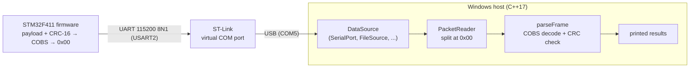

# STM32 Serial Telemetry

An STM32 NUCLEO-F411RE board streams framed telemetry packets over UART, and a Windows C++17 host program reads them, splits the byte stream into frames, verifies each one with a CRC, and prints the result.

Both halves are written from scratch. The firmware is in C on the STM32 HAL, and the host is in C++17 using the Win32 serial API, with no third-party libraries.

## How it works



### Frame format

```
COBS( payload | crc_hi | crc_lo ) | 0x00
```

| part | meaning |
|---|---|
| payload | the data; the firmware currently sends 3 bytes, `11 22 <counter>` |
| `crc_hi crc_lo` | CRC-16/CCITT of the payload (init `0xFFFF`, polynomial `0x1021`), high byte first |
| COBS | Consistent Overhead Byte Stuffing: rewrites the bytes so `0x00` never appears inside a frame (adds exactly 1 byte) |
| `0x00` | delimiter: marks the end of every frame |

Because `0x00` can only mean "end of frame", the reader never has to trust a header or a length byte. A corrupted frame costs exactly that one frame, and the next `0x00` resynchronises the stream. The counter goes up by one with every frame, so a gap in it shows that frames were lost.

Example on the wire, counter `0x05`: `06 11 22 05 88 EE 00`.

### Host design

| component | role |
|---|---|
| `DataSource` | interface: `readChunk()` returns whatever bytes are available (it may be empty), and `isFinished()` reports end of stream |
| `SerialPort` | `DataSource` over a Windows COM port (RAII handle, 8N1, 1 s read timeout); throws on I/O errors |
| `ChunkListSource` | `DataSource` that replays hand-written chunks, used for testing without hardware |
| `RecordingSource` | wraps another `DataSource` (owned through `std::unique_ptr`) and writes every byte it passes on to a file |
| `FileSource` | `DataSource` that replays a recorded file in fixed-size chunks |
| `PacketReader` | keeps leftover bytes between reads and cuts a frame at each `0x00`, so frames split across reads are reassembled |
| `parseFrame` | COBS-decodes one frame and checks its CRC-16 |
| `Cobs`, `Crc16` | `cobsEncode` / `cobsDecode` and `crc16`, written with pointer + length so the same code runs on the board |
| `Pipeline` | `runPipeline(source, reader, maxReads)` is one loop that works with any `DataSource` |

`telemetry` picks its source at runtime and owns it through `std::unique_ptr<DataSource>`. Because `runPipeline` only depends on the `DataSource` interface, the same code runs against the real board, a recorded file, or scripted test data.

## Repository layout

```
firmware/Telemetry_Firmware_F411/   STM32CubeIDE project (send loop in Core/Src/main.c, crc16.c, cobs.c)
host/                               C++17 host: telemetry program, sources, reader, parser, tests
host/samples/capture.bin            a real recording from the board, for replay without hardware
```

## Building and running

### Firmware
1. Import `firmware/Telemetry_Firmware_F411` into STM32CubeIDE (File → Import → Existing Projects into Workspace).
2. Build and run it on a NUCLEO-F411RE. The green LED blinks once per frame sent.

### Host (Windows, GCC via MSYS2)
From `host/`:
```
g++ -Wall -Wextra -std=c++17 telemetry.cpp Pipeline.cpp SerialPort.cpp ChunkListSource.cpp RecordingSource.cpp FileSource.cpp PacketReader.cpp Parser.cpp Cobs.cpp Crc16.cpp -o telemetry
```

| command | what it does |
|---|---|
| `.\telemetry serial` | read live frames from the board on `COM5` |
| `.\telemetry record <file>` | read live frames and save every raw byte to `<file>` |
| `.\telemetry replay <file>` | replay a recording, no board needed (try `samples\capture.bin`) |
| `.\telemetry test` | run built-in test chunks: split frames, a zero byte inside a payload, and a corrupted CRC |

Unit tests for the framing code:
```
g++ -Wall -Wextra -std=c++17 crcTest.cpp Crc16.cpp -o crcTest
g++ -Wall -Wextra -std=c++17 cobsTest.cpp Cobs.cpp -o cobsTest
```
`crcTest` checks the standard CRC-16/CCITT check value (`0x29B1` for `"123456789"`). `cobsTest` checks that encode followed by decode returns the original bytes, and that a malformed frame is rejected.

`telemetry serial` opens `COM5`. Check which COM port the board uses in Device Manager → Ports (COM & LPT).

### Example output
A real `telemetry serial` run with the board connected. Frames often arrive split across reads, and `PacketReader` reassembles them:
```
Chunks received: 1
Packets created: 0
Chunks received: 2
Packets created: 0
Chunks received: 3
Packets created: 1
 VALID    ->    Payload size : 3
11 22 10
Chunks received: 4
Packets created: 0
Chunks received: 5
Packets created: 1
 VALID    ->    Payload size : 3
11 22 11
...
COM5 port is now closed.
```

## Known limitations

- **Frame size:** the COBS implementation handles frames shorter than 254 bytes, which covers the current 5-byte frames. Longer frames need the extra `0xFF` code-block rule.
- **No delivery guarantee:** bytes sent while no program has the port open may be dropped. The counter makes these gaps visible.
- **Read limit:** `runPipeline` stops after `maxReads` reads, so a long recording is only partly replayed.

## Roadmap

- [x] Firmware UART send loop; host receives, reassembles and validates packets
- [x] `DataSource` interface; serial, test, recording and file-replay sources share one pipeline
- [x] `std::unique_ptr` ownership of sources, chosen at runtime
- [x] COBS framing with a `0x00` delimiter, plus CRC-16, on both ends
- [ ] Fault-injecting source for robustness tests
- [ ] CMake build, GoogleTest unit tests, CI
